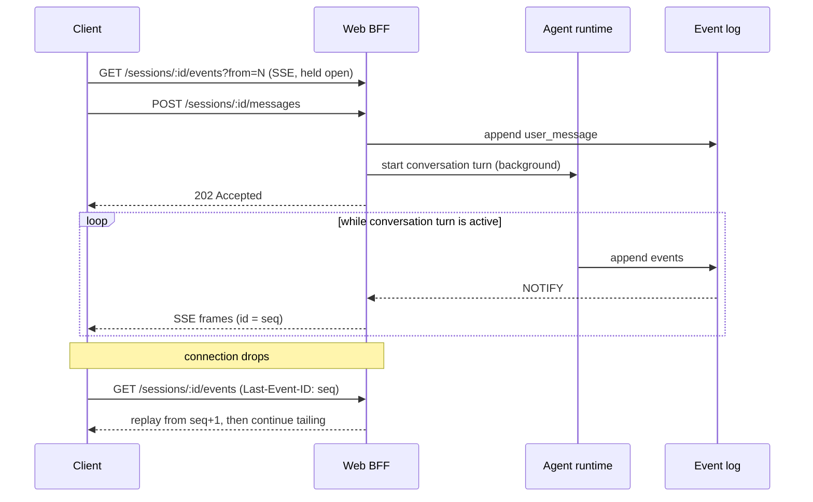
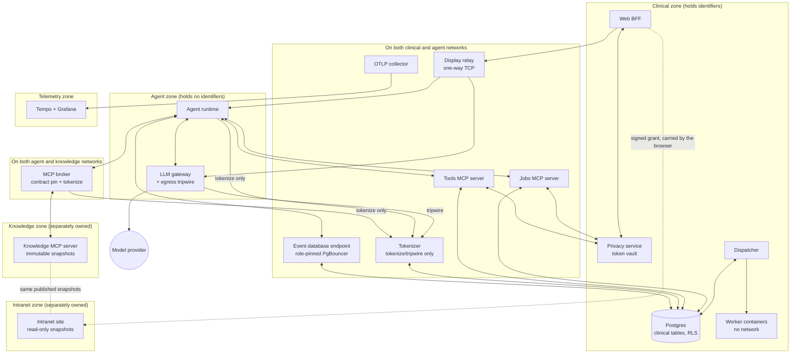

# Architecture

This document records the decisions that are expensive to reverse and the reasoning behind
them. It deliberately stops short of implementation detail: where a choice is local to one
module and cheap to change later, it is the implementer's call, not this document's.

**Implementation status:** PLAN1 through PLAN8 are implemented. The local stack tokenizes at
ingress, resolves only at clinical tool/display edges, restricts runtime database credentials,
and checks outbound requests with a keyed-hash tripwire. X-ray shows actual recorded model
requests. Draft editing, exact-hash confirmation, synthetic Docker execution, MCP-owned live
views, SOP retrieval, turn recovery, and persisted session titles are available. Compose network
zones separate clinical, agent, knowledge, and telemetry services; this local
development deployment is not a production security certification.

**Contents**

1. [Guiding constraints](#1-guiding-constraints)
2. [The two-tier guarantee model](#2-the-two-tier-guarantee-model)
3. [The event log is the spine](#3-the-event-log-is-the-spine)
4. [Conversation turns are decoupled from connections](#4-conversation-turns-are-decoupled-from-connections)
5. [The agent is an interface](#5-the-agent-is-an-interface)
6. [Zones and the privacy boundary](#6-zones-and-the-privacy-boundary)
7. [Handles, not rows](#7-handles-not-rows)
8. [Views are declarative specs](#8-views-are-declarative-specs)
9. [Drafts and confirmation](#9-drafts-and-confirmation)
10. [Job execution](#10-job-execution)
11. [Gateways](#11-gateways)
12. [Knowledge base](#12-knowledge-base)
13. [Evidence architecture](#13-evidence-architecture)
14. [Service topology](#14-service-topology)
15. [Stack](#15-stack)
16. [Non-goals](#16-non-goals)
17. [Requirement register](#17-requirement-register)
18. [Decision log](#18-decision-log)

---

## 1. Guiding constraints

Three constraints shaped nearly every decision below.

**Push guarantees out of the model and into infrastructure.** Anything a deterministic
mechanism can enforce should be enforced there, because a closed door beats a high pass rate.
What remains model-dependent gets measured honestly rather than asserted.

**Correctness must be visible at every increment.** The project is built as a sequence of
shippable steps, each ending with something rendered on screen and a suite that goes green.
This ruled out several architectures that are only testable once fully assembled.

**Evidence must be cheap to produce.** If regenerating the report costs money or flakes, it
stops happening. Determinism and replay are therefore architectural requirements, not testing
conveniences.

---

## 2. The two-tier guarantee model

Every behavioral requirement is classified as an **invariant** or a **measured property**, and
the classification drives both the implementation and the reporting.

An **invariant** is enforced by construction. The mechanism is a type boundary, an absent
capability, a database policy, or a network rule. Its evidence is a property test plus, where
applicable, a fault-injection test proving the mechanism is actually load-bearing. Invariants
are reported as pass/fail.

A **measured property** depends on model judgment. Its evidence is a pass rate over k trials on
a labeled case set, reported with a Wilson confidence interval, gated on the lower bound.

The distinction is not cosmetic. Two examples of where it bites:

- Removing the job-submission tool from the model's schema makes unauthorized submission
  impossible. But nothing prevents the model from *claiming* it submitted a job. The first is
  an invariant, the second is a measured groundedness property, and a system that reports only
  the first is misleading.
- Tokenizing identifiers before the LLM gateway is an invariant for identifiers the rule set
  matches. Whether the rule set matches a given obfuscated mention is a measured detector
  recall property. Collapsing these into "PHI is protected" is the kind of overclaim this
  architecture exists to avoid.

The [requirement register](#17-requirement-register) is the authoritative classification.

---

## 3. The event log is the spine

A single append-only, per-session event log in Postgres is the system's source of truth for
everything a session did.

A **conversation turn** begins with one user message and includes the agent's processing,
model/tool steps, and response until completion or failure. A session contains many conversation
turns, with at most one active at a time. A **job run** is a separate analysis execution: it can
outlive the conversation turn that prepared its draft and is not the unit of chat streaming.

```
events(session_id, seq, conversation_turn_id, schema_version, type, payload, created_at)
  primary key (session_id, seq)
```

Lifecycle events are `conversation_turn_started`, `conversation_turn_finished`, and
`conversation_turn_failed`. The current event schema is v2. Original v1 events remain immutable
in storage and are translated to the current vocabulary on read; the identifier column is
renamed by a migration, with sequence numbers and payloads preserved.

`seq` is monotonic per session, allocated by incrementing a counter column on the session row.
That row lock serializes appends within a session, which is the desired behavior anyway, and it
avoids the gap and out-of-order-visibility problems a shared sequence introduces for a reader
that must not skip.

Conversation and workflow state are projections of this log: the rendered transcript, the right
panel's view stack, drafts/jobs, and the eval trace. Session organization is persisted metadata:
creation time, title, title origin, and the one-time naming claim live on the session row, with
a separate metadata notification feed. Three consequences follow, and they are the reason
for the design.

**Stream resume is a read.** A reconnecting client asks for events after a sequence number.
There is no special recovery path to get subtly wrong.

**View history is free.** Back and forward navigation on the working surface is movement
through a filtered projection, not separately managed UI state.

**Behavioral assertions run against the bytes the UI rendered.** The eval harness reads the
same log the client reads. There is no separate instrumentation path that can drift from
production behavior, which is the failure mode that makes most agent test suites decorative.

Two design rules protect this. First, anything worth asserting about must be a structured
event: refusals go through a `refuse(reason)` tool rather than improvised prose, drafts are
state, views are specs. This converts most behavioral checks from fuzzy judgment into
deterministic assertion. Second, the event schema is versioned, and the client reducer must
support removal (`message_dropped`) from the start, even before anything emits it. A resumed
conversation turn that re-executes an interrupted model call needs to retract a partial
message, and an append-only reducer is a rewrite at that point.

Token deltas are coalesced on a short timer before being appended, so streaming does not mean
one row per token.

---

## 4. Conversation turns are decoupled from connections

Posting a message starts a background conversation turn and returns immediately. It does not
return the stream. The client is separately subscribed to the session's event feed and sees
the conversation turn's output arrive there.



This is the single most important structural decision in the project, and the one most
expensive to retrofit. An architecture where the POST response *is* the stream ties
conversation turn lifetime to connection lifetime, which means a refresh kills work in progress and every
durability guarantee becomes a special case. Building it the other way costs almost nothing on
day one.

It also makes multi-tab and multi-device viewing fall out for free, since every viewer uses the
same tail-the-log code path.

SSE was chosen over WebSockets because `Last-Event-ID` is exactly the resume primitive needed
and the protocol is otherwise plain HTTP. The known cost is that `EventSource` cannot set
request headers, so authentication rides a cookie or the client moves to a streaming `fetch`.

---

## 5. The agent is an interface

```
Agent.run_turn(session, emit) -> None
```

Two implementations share this interface, and nothing else in the runtime knows which
one is running:

| Implementation | Purpose |
|---|---|
| `ScriptedAgent` | A canned event sequence. Deterministic, no provider, no key. |
| `LlmAgent` | The real loop, with replay, record, or live selected inside the model gateway. |

This is what makes the build order possible. The event log, the streaming layer, the entire
front end and the whole evidence harness are built and proven against `ScriptedAgent`, before
an LLM is in the picture. When the real loop arrives, the existing goldens are the regression
test for it.

It is also what makes CI free and deterministic. Pull requests run `LlmAgent` with gateway
replay, alongside retained scripted transport fixtures. There is no separate replay loop or
harness-level provider mock. Nightly evaluations will use the same agent across configured
model routes, and the resulting drift is a reviewable diff.

---

## 6. Zones and the privacy boundary

The application has clinical, agent, and neutral zones. Compose maps them to separate internal
Docker networks (`clinical`, `agent`, `knowledge`, `intranet`, `telemetry`). Two containers on
different networks have no route to each other, so an allowed cross-zone flow requires a service
deliberately attached to both.



**Identifiers are tokenized at ingress and resolved only at the edges that need real values:**
the tools gateway, which must execute against real data, and the web stream, which must display
real values to an authorized human. Everything between, including the agent runtime, the event
log and the LLM gateway, holds tokens only.

This is deliberately the PCI tokenization pattern rather than a filter in front of the model
call. The difference matters: a filter protects one call site, while tokenization at ingress
takes the entire agent zone out of scope, which means the invariant can be verified by scanning
everything the agent zone ever stored rather than by auditing every call path.

Every path into model context counts as an ingress. That includes user text, tool results, job
logs, retrieved documents and interaction events coming back from rendered views. Missing one
of these is the most likely way to break the invariant, which is why the boundary is a typed
one: values are `Raw<T>` or `Tokenized<T>`, and only an explicit tokenize step converts.

Three layers back the invariant up:

1. **The type boundary** prevents it at compile or validation time.
2. **Network zones** deny the agent zone any route to clinical data, and grant internet egress
   to the LLM gateway alone. The boundary should be enforced, not documented, and a probe from
   each service's exact network position verifies it.
3. **An egress tripwire** in the LLM gateway matches keyed hashes of every known identifier on
   every outbound request and fails the request loudly. The gateway holds hashes, never
   identifiers, so the tripwire itself is not a leak.

Detokenization on the display path needs a small holdback buffer, because a token can straddle
two streamed chunks.

Two supporting decisions reduce how often identifiers are needed at all. Tools accept relative
time windows rather than dates, because dates are quasi-identifiers and a relative window is
what the user meant anyway. And cross-site isolation is enforced by Postgres row-level security
rather than by query construction, so it holds regardless of what the agent asks for.

The physical database is only on the clinical network. The event database endpoint has one forced
`zagent_runtime` backend mapping, no owner credential, and session pooling; the runtime cannot
connect to Postgres directly or read clinical/vault/workflow tables through the proxy. Privacy
uses separate services: `privacy` (8003, clinical only) resolves, while `tokenizer` (8006) has
only tokenization/tripwire routes. The agent zone cannot connect to 8003 or the display BFF, by
name or by container IP. The BFF reaches the runtime and gateway through a one-way relay whose
listeners forward only into the agent zone.

Docker networks cannot filter by port, so every service attached to both zones is trusted to
serve only its fixed agent-facing port and never forward. Only the LLM gateway has public TCP/443
egress among application workloads. Workers run with no network at all. Loopback host access
goes through an ingress forwarder on an edge network with outbound NAT disabled. Probes pair
denials with working allowed routes, so a denial cannot pass because a service is down.

The `intranet` network holds only `kb-site`, the knowledge team's read-only intranet
([section 12](#12-knowledge-base)), which mounts the published snapshot volume read-only. Its own
`intranet-ingress` relay publishes one loopback port. It is separate from the main ingress because
a relay listens on every network it joins: sharing one would give the site a route to the
services behind the main ingress. The site reaches no other zone, and no zone reaches it
(REQ-KB-06).

---

## 7. Handles, not rows

Data-returning tools return a query handle, a row count and a schema. They do not return rows.
View-pushing tools take a handle. The model composes a view over data it never sees.

This began as a privacy measure and turned out to be the better design regardless.

- It bounds context growth. A thousand-row result costs the same context as a ten-row one.
- It keeps views live. A view bound to a handle re-reads on render, so a job monitor reflects
  current state instead of a snapshot from when the model spoke.
- It removes the largest class of hallucination. The model cannot misreport a value it was
  never given.

The cost is that the model cannot reason over result contents. Where that is genuinely needed,
a tool returns an explicit aggregate (a count, a distribution, a named summary) rather than the
underlying rows. In practice this has been sufficient, and it is a useful forcing function: it
surfaces which questions actually require data in context and which were only convenient.

---

## 8. Views are declarative specs

The working surface renders views described by `{kind, version, props}`, validated against a
JSON Schema at the boundary. The model never emits markup or code.

There are two sources of views, and they have different owners.

**Tool-owned views** are shipped by the tool that produces them: a job card, a submission form,
a log tail. These follow the MCP Apps extension, where a tool declares a `ui://` resource and
the host renders it in a sandboxed frame with JSON-RPC message passing. The jobs MCP server
carries its own job card. This is what makes "connect another MCP server later" a real
capability rather than a slide: a new server brings its own views with it.

**Agent-composed views** are ad hoc tables and charts assembled by the model from a small
registry of kinds. Charts use a Vega-Lite subset, so the spec is portable and validatable
rather than bespoke.

The registry is intentionally small and grows one kind at a time. A large view vocabulary
introduced early is untestable surface area.

PLAN3 implements only table v1. One JSON Schema under `services/agent/zagent/view_schemas/`
is used on both sides of the HTTP boundary, with cell/column consistency checks alongside it.
`view_pushed` carries a stable `view_id` and a validated spec. Invalid specs fail the conversation
turn before append; earlier views remain intact. Rows are text/scalars, never executable markup.

View and step stacks are event projections in both Python and TypeScript. The browser stores
only a selected view ID in the URL; it never stores a separate copy of the stack. No selected
ID means follow the newest view. Navigation to an older ID pins it across refresh and future
pushes; selecting the head resumes following. Compact screens expose chat and surface as tabs.

The renderer registry discovers versioned components independently of the panel and reducer.
Table props allow inline fixture rows or a session-scoped handle source. PLAN7 adds generated
draft forms and pending job cards. Chat links use persisted publication identity, kind, and title;
they never parse model-written URLs. Explicit `view` selections remain pinned even at the head,
and missing targets do not select another view. Step markers are collapsed disclosures over
started/finished step events.

PLAN8 moves job rendering to the jobs MCP server's `ui://jobs/card` and `ui://jobs/grid` resources.
The host uses the official MCP Apps AppBridge/PostMessageTransport in an opaque-origin
`allow-scripts` iframe, with a restrictive CSP and no network or arbitrary navigation capability.
It permits only a read of the bound published view, not arbitrary tool arguments. The BFF fetches
the resource and job data over MCP and relays read-only job notifications. Handles identify live
queries; immutable publication events do not accumulate progress noise. Legacy v1 job-card
events use the same server-owned renderer, while new cards use v2 handle bindings.

---

## 9. Drafts and confirmation

A job draft is a persisted, versioned object. Chat and the form in the right panel are two
editors over the same object, which is what collapses the two interaction styles in the
original concept into one state machine: a natural-language correction and a form edit are the
same mutation.

Confirmation carries the version hash of the draft the user was looking at. If the agent
mutated the draft after the card rendered, the confirmation is rejected and the user is shown
what changed.

This is the mechanism behind the confirmation invariant, and it is stronger than the obvious
implementation. Simply requiring a button click leaves a race in which the agent alters
parameters between render and click. Binding the confirmation to a specific version means the
user always confirms exactly the thing they saw. The model has no submit tool at all, only
draft mutation, so submission is structurally a human action.

PLAN7 implements this with draft/revision rows and pending jobs. A single transaction locks the
session and draft, compares the semantic content hash, reruns deterministic validation, writes
one job, and publishes its events/view. Repeated confirmation returns that job. A stale hash
returns a field-level diff. The hash covers application, specimen handle, and parameters, not
validation messages, timestamps, or display hints. Integral numeric values are canonicalized.
Form and model patches share the validator; null removes an incorrect parameter. Generated
forms accept a checked scalar JSON Schema subset and a catalog layout hint.

Confirmation is exposed only at the display API, never as a model tool, and draft/job tables
are denied to the runtime role. The local stack has no production authentication, so this
capability boundary is not a claim that arbitrary HTTP clients are authorized humans.
New confirmations also freeze private execution inputs and enqueue work atomically. Human workflow events can append after the
originating conversation turn ends without reopening or changing that turn's lifecycle.

Sessions sort by descending creation time and ID. Stable fallback names are persisted before
any model call. One optional background title generation uses tokenized conversation through
the same gateway, is bounded by time/output limits, and claims eligibility atomically. Automatic
results apply only while the title remains a fallback, so a concurrent manual rename wins.
Naming does not delay completion, block the next turn, or reorder sessions.

Archiving sets `sessions.archived_at`; nothing is deleted, so the event log and audit records
stay intact. Archived sessions leave `GET /sessions` (`?archived=true` lists them) and refuse
messages and draft changes, while snapshots, events and X-ray stay readable. The display API
answers `409 work_in_progress` while a turn runs or jobs are unfinished, unless the request
forces it; a forced archive asks the runtime to stop the running turn, which then fails with
"Stopped because the session was archived." Jobs are not cancelled.

---

## 10. Job execution

The queue lives in Postgres. Rows are claimed with `SKIP LOCKED`, and enqueueing happens in the
same transaction as the job row so the two cannot diverge. A dedicated queue broker would add
an operational component and a consistency boundary for no benefit at this scale.

The dispatcher targets an `Executor` protocol, with Docker execution under Compose and a native
process implementation for controlled tests. The catalog supplies
command and parameter schema; deployment selects the worker image.
Lease revisions fence stale monitors; deterministic container names and input fingerprints make
reconciliation idempotent. Attempt/log sequence uniqueness prevents duplicate ingestion after
a crash. Synthetic eviction retries once with a distinct attempt name; ordinary failures do not.
A terminal receipt is recorded before cleanup, so recovery completes a job without re-running it
if cleanup was interrupted.

The worker reads confirmed fixture facts, not mutable query results. Role disagreement causes
somatic failure; verified-role selection fixes the input without editing clinical records.
Coverage, purity, eviction, and long-running outcomes also derive from fixture data. Workers emit
OTel-compatible JSONL. The dispatcher tokenizes before saving logs or exporting spans through the
OTLP HTTP collector. The model reads at most ten summarized log lines per request; the live card
tails forty and the database retains all ingested lines. Raw Docker stdout/input belongs to the
clinical zone. Completed containers are retained locally for audit and reconciliation.

The Docker socket makes the local dispatcher privileged. Workers have no network or credentials
and run non-root with filesystem and resource restrictions, but this is not production sandbox
certification. External deletion of an execution container is outside restart recovery's contract.

Job runs are single-step and have no sub-workflow, so they need no workflow engine. Durable
execution also matters within a *conversation turn*, which can contain multiple model and tool
steps. That is served by journaling the conversation turn into the same event log rather than
by adding Temporal. Workflows that wait on a human span conversation turns; the wait between
turns lives in persisted session and draft state.

The LLM runtime checkpoints its scope decision and each tokenized model completion before
emission. Tool operations have stable IDs and commit their mutation plus receipt in one database
transaction. Recovery uses saved responses/results, finishes incomplete steps, and emits
`message_dropped` before replacing partial text. The visible final projection agrees; the audit
log additionally preserves the interruption/retraction. One database advisory lock owns the
runtime. Token allocation has its own per-session advisory lock, while tool session writes use
non-key row locks so remote privacy inserts do not deadlock against mutation receipts.

Trace context is persisted with conversation turns, propagated over HTTP/MCP, and copied into the
private confirmed input. Dispatcher execution and tokenized log spans join that conversation's
Tempo trace, viewable in Grafana. Workers emit the same trace ID but do not need network access
to the collector. A separately tracked immutable worker image avoids rebuilding every service
for the dispatcher's image reference.

---

## 11. Gateways

**The LLM gateway** is a thin in-house service rather than an off-the-shelf proxy, for one
reason: record and replay keyed on a normalized request hash is a hard requirement of the
evidence architecture, and it is easier to own than to bolt on. It also holds per-request model
routing for the nightly matrix, and the egress tripwire. It is the only component with internet
egress.

**The tools gateway** is an MCP client and, at the same time, the policy enforcement point. All
of the following happen there and nowhere else: tool allowlisting, argument schema validation,
token resolution, result tokenization, and audit logging. Concentrating policy in one place is
what makes it auditable.

Results from third-party MCP servers are treated as untrusted content on the same footing as
user input. They are tokenized, and they are never interpreted as instructions. Knowledge tools
reach the tools gateway through `mcp-broker` (section 12), which verifies the caller context,
pins the upstream contract and tokenizes results before they enter the agent zone.

---

## 12. Knowledge base

A separately owned service in its own `knowledge` zone (PLAN12). Its package,
`services/knowledge` (`zknowledge`), imports nothing from the agent and publishes its MCP tool
contract as JSON. An offline `kb-publish` job builds immutable SQLite FTS5 snapshots into a
volume. Connectors normalize five source systems (a Confluence-style wiki export, a QMS register
with Markdown and PDF-text bodies, a ticketing export, reference tables, and pinned Wikipedia
articles) into canonical citation lines and section outlines. Publishing checks gate provenance,
access labels, supersession and table-to-document consistency. The server serves the current
snapshot or a retained one named in request metadata, and every result carries its snapshot ID.

Five read-only tools: `search_knowledge` ranks fixed-size passages with BM25, glossary synonym
expansion and an authority prior; `get_document` returns status, visible versions and an outline;
`read_document` returns one section or at most thirty numbered lines; `lookup_term` returns a cited
glossary entry; `query_reference` returns bounded reference-table rows, each with its source line.
The index filters by the caller's site and roles before ranking, so restricted and missing
documents look the same. Retrieval quality is measured on labeled queries in
`services/knowledge/evals`.

The agent zone reaches it only through `mcp-broker`, which sits on the agent and knowledge
networks. The model sees tool definitions owned by the agent repository (`kb_tools.py`); the
broker pins a hash of the upstream input schemas and disables the tools when it changes,
validates every result against agent-owned output models, bounds time, and tokenizes results as
external content before they enter the agent zone. The agent therefore does not rely on the
corpus being free of identifiers. The runtime records the snapshot a conversation turn first read
on the turn itself and sends it with every later knowledge call of that turn, including after a
resume, so one answer never mixes snapshots.

The prompt states the authority rule: effective controlled documents govern; wiki pages and
tickets are context; public articles explain concepts and never set a threshold. Answers cite
`[document@version:Lstart-Lend]`, where the document version is the human-facing version and
the snapshot ID stays in the tool audit. Reference-table rows are the one documented exception
to "handles, not rows": they are non-clinical, bounded and cited.

Identity is simulated but verified. A session records one of four personas, each with knowledge
roles. For every conversation turn the BFF mints a short-lived Ed25519-signed caller context
(session, turn, site, persona, roles) and stores it with the turn, so a resumed turn reuses it.
The runtime forwards it as MCP request metadata on knowledge calls only and cannot open or widen
it: it holds no key. The broker, which alone holds the verification key, checks the signature,
expiry and the session and turn it is bound to, then sends only the verified site and roles
upstream. A missing, forged or expired context fails closed as `unavailable`; model arguments
cannot carry site or role fields because the tool schemas forbid extra properties.

Immutability buys determinism: a KB version is a build artifact, so a retrieval result is
reproducible and the eval report can pin it. Indexing at line granularity lets answers cite
line ranges. The current deterministic check validates that every cited range was read at that
version and that quotations are verbatim; it does not prove that every paraphrased claim is
semantically entailed.

**Citations open the source (PLAN13).** The knowledge team also runs an intranet
(`zknowledge.site`). It renders every snapshot document on a page shaped like its source system:
a wiki page, a controlled QMS document with its revision history, a service-desk ticket, the
glossary and reference tables, and a library article. Each canonical line has its own anchor.
`/d/<document>?snapshot=&lines=&q=` resolves a citation to that page, pinned to the cited
snapshot, with the cited lines highlighted and the quotation emphasized. A later edit shows a
banner; an expired snapshot falls back to the current one with a notice. Pages are built from
what snapshots already hold, so the snapshot ID the model sees is unchanged.

In chat, the client turns each citation into a chip. Its label and hover preview come from the
conversation's own `read_document` result, in the display representation, so the preview needs
no request. A citation that no read covers is marked unverified but still opens. Clicking posts
the citation to the BFF, which mints a 60-second, single-use Ed25519 grant for the session's own
site and persona (audience `zknowledge-site`) and redirects. The site verifies it with its own
key, signs the visitor in, and redirects to a clean URL. The browser cannot choose the persona,
cross-site posts are refused, and neither the quotation nor the grant appears in an access log.
The site applies the index's visibility rules itself, so restricted and missing documents look
the same on every page, listing and search result (REQ-ACL-03, REQ-ACL-04). A labeled mock
sign-in exists for browsing. A test resolves every citation in the recorded cassettes on the site
and compares the highlighted lines with the lines the agent read, matching each privacy token to
the identifier it replaced (REQ-CITE-01). The model sees nothing new: no prompt, tool or cassette
changed.

---

## 13. Evidence architecture

**Requirements are code.** Each has an ID, a tier, a threshold and linked cases. The report is
a traceability matrix. When a requirement turns out to be ambiguous, the resolution is a new
labeled case, which makes the case set the executable specification.

**Golden transcripts are the primary regression mechanism.** Each case writes a normalized
event log (types plus significant payload fields, with ids and timestamps redacted) to a
checked-in golden file. A behavior change is a reviewable diff. This is the cheapest and
highest-leverage piece of the whole system, which is why it is built second rather than last.

**Cases drive the real HTTP API**, not internals. One runner serves both the test suite and the
`zagent evals` CLI, so there is no second code path that can pass while production fails.

PLAN2 implements this through a local instance of the production HTTP application on an
ephemeral loopback port and a dedicated test database. Each case starts with `POST /sessions`;
evidence comes from SSE plus `GET /snapshot`. Case groups, requirement links, and expected
transcripts live under `evals/`. Golden references execute twice to reject hidden nondeterminism.
Goldens cover projected chat state as well as normalized events, so reducer regressions are
visible. Unknown assertions are configuration errors, not ignored extensions.

**Statistics are reported honestly.** k trials per case at production settings. Wilson intervals
on pass rates, gated on the lower bound. `pass^k` reported separately for properties that must
hold on every attempt. Version comparisons use paired tests, so "regression" is a claim with
support rather than a difference in two numbers.

The PLAN2 scripted fixture accelerates timing and records that exception in provenance; it
does not measure model quality or latency. Its report uses per-case distinct-trial `pass^k`
estimates and exact paired McNemar comparisons. Measured gates require their registered sample
minimum as well as a sufficient Wilson lower bound. Uncovered requirements fail the gate.

**Simulated users** carry hidden goals for multi-turn slot filling, and are scored on whether
the final draft matches the goal. The simulator's model is pinned independently so its drift is
not misread as agent drift.

**The suite is tested against itself.** Fault-injection flags disable each mechanism in turn,
and CI asserts the suite goes red for each. A green suite that cannot detect a broken build is
not evidence.

**Provenance is recorded per result**: model, prompt hash, tool schema hash, KB version, seed,
and commit. Determinism is maintained through an injectable clock, seeded fixtures and a seeded
simulator.

---

## 14. Service topology

| Service | Zone | Responsibility |
|---|---|---|
| Web BFF | Clinical | HTTP and SSE to the browser, display-path detokenization, signing each turn's caller context and citation sign-in grants |
| Agent runtime | Agent | Conversation turn execution, the scope guard, conversation turn journaling |
| LLM gateway | Agent | Provider routing, record and replay, egress tripwire. Sole internet egress |
| Knowledge MCP server | Knowledge | Separately owned package serving immutable snapshots; no route to other zones |
| Intranet site (`kb-site`) | Intranet | Separately owned, read-only pages over the published snapshots; verifies citation sign-in grants |
| Intranet ingress | Edge and intranet | Loopback-only intranet port, separate from the main ingress |
| MCP broker | Agent and knowledge | Only agent-zone route to knowledge: caller verification, contract pinning, snapshot forwarding, tokenization |
| Tools and jobs MCP servers | Clinical and agent | MCP servers and policy enforcement points |
| Privacy service | Clinical | Token vault, detector rule set, tokenize and resolve |
| Tokenizer | Clinical and agent | Tokenize and tripwire only; no resolve routes |
| Event database proxy | Clinical and agent | PgBouncer pinned to the `zagent_runtime` role |
| Display relay | Clinical and agent | One-way TCP forward from the BFF to the runtime and gateway |
| Dispatcher | Clinical | Claims queue rows, starts worker containers, tails logs |
| Worker containers | No network | Single-step analysis containers |
| Postgres | Clinical | Event log and clinical tables, separated by role and RLS |
| OTel collector | All zones | Receives OTLP traces, using GenAI semantic conventions |
| Tempo and Grafana | Telemetry | Trace storage and a local UI on a loopback port |
| Ingress | Edge | Loopback-only host ports; no outbound NAT |

The web BFF sits in the clinical zone because it performs display detokenization. The agent
runtime sits in the agent zone and never holds a real identifier.

---

## 15. Stack

Choices favor what is already fluent over what is novel, because the interesting parts of this
project are the boundary and the evidence, and neither benefits from stack learning curves.

| Layer | Choice | Reasoning |
|---|---|---|
| Backend | Python 3.12, FastAPI, Pydantic v2, uv | Pydantic gives schema validation at every boundary, which the view specs, tool arguments and event payloads all need |
| Database | Postgres 16 | Event log, queue, clinical tables and RLS in one component |
| Streaming | SSE | `Last-Event-ID` is the exact resume primitive required |
| Frontend | React 19, TypeScript, Vite, TanStack Router, Tailwind, shadcn/ui | Typed view-spec rendering and a small component surface |
| Local dev | Docker Compose with internal networks per zone | One command, and zones are enforced by Docker network isolation without cluster tooling |
| Evidence | pytest plus an `zagent evals` CLI | One runner, two entry points |
| Tracing | OpenTelemetry, Tempo | Job logs already arrive as OTel JSONL |
| Tools and views | MCP, MCP Apps | Extensibility that is real rather than claimed |

**On Rust:** the one component where a type system materially strengthens a guarantee is the
privacy service, where `Raw<T>` and `Tokenized<T>` can make a boundary violation a compile
error. It is an optional substitution at [PLAN6](PLAN6.md), not a prerequisite.

---

## 16. Non-goals

Stated explicitly, because each was considered and declined.

- **Multi-tenancy and real authentication.** Single-user, with RLS demonstrating the isolation
  mechanism. Auth is orthogonal and adds no architectural insight here.
- **Real analysis pipelines.** Jobs emit realistic telemetry against synthetic inputs. Running
  actual aligners would add hours of compute and nothing to the demonstration.
- **A workflow engine.** Jobs are single-step. See [section 10](#10-job-execution).
- **Model training or fine-tuning.** The subject is agent system design and evaluation.
- **Horizontal scale.** Correct under concurrency, not tuned for throughput. Where the design
  would not scale, the document says so rather than pretending.
- **Compliance certification.** The privacy boundary is a demonstrated architecture, not an
  attested control.

---

## 17. Requirement register

The authoritative list lives in `evals/requirements.yaml` and is the source for the report. The
shape of an entry:

```yaml
- id: REQ-PHI-01
  tier: invariant
  statement: >
    No identifier matched by the detector rule set appears in any request
    leaving the LLM gateway.
  enforced_by:
    - privacy/tokenize.py           # ingress tokenization
    - gateway_llm/tripwire.py       # keyed-hash egress check
    - deploy/compose/compose.yaml   # network zones
  cases: [PHI-001 .. PHI-062]
  mutations: [tokenizer_off, tripwire_off]

- id: REQ-SCOPE-01
  tier: measured
  statement: Off-topic requests are refused with a structured refusal event.
  threshold: {metric: recall, min_lower_bound: 0.95, trials: 10}
  cases: [SCOPE-001 .. SCOPE-050]
```

Invariants name their enforcement sites and the mutations that must break them. Measured
properties name a metric, a lower-bound gate and a trial count. Both name their cases, which is
how the traceability matrix is generated rather than maintained.

---

## 18. Decision log

| # | Decision | Alternative rejected | Because |
|---|---|---|---|
| 1 | Append-only per-session event log as the single source of truth | Conventional message table plus separate telemetry | One spine gives resume, view history and eval traces from the same bytes |
| 2 | Conversation turns decoupled from connections | POST returns the stream | Connection lifetime must not bound work lifetime |
| 3 | SSE with `Last-Event-ID` | WebSockets | Resume is the primitive needed, and the rest is plain HTTP |
| 4 | Per-session sequence via a session counter row | Global sequence | Readers must not skip, and gaps make that unsafe |
| 5 | Agent as an interface, scripted first | Build against a real provider | Enables the entire front end and harness to be proven before any LLM |
| 6 | Tokenization at ingress | Filter in front of the model call | Removes the whole agent zone from scope, so the invariant is verifiable by scanning storage |
| 7 | Typed raw/tokenized boundary | Runtime checks only | Every ingress path must be covered, and types cover them structurally |
| 8 | Handles instead of rows | Rows in tool results | Bounds context, keeps views live, removes a hallucination class |
| 9 | Declarative view specs | Model-generated markup or code | Validatable, snapshot-testable, safe to render |
| 10 | MCP Apps for tool-owned views | Bespoke view registry only | Third-party servers bring their own views, so extensibility is real |
| 11 | Version-hashed confirmation | Plain confirmation button | Closes the race between render and click |
| 12 | No submit tool exposed to the model | Submit tool plus policy prompt | Makes unauthorized submission structurally impossible |
| 13 | Postgres queue with `SKIP LOCKED` | Dedicated broker | One fewer component, and transactional enqueue with the job row |
| 14 | Docker worker containers for execution | Kubernetes Jobs | One bounded retry is simple to own, and a cluster is disproportionate for a demo |
| 15 | Conversation turn journaling in the event log | Temporal or similar | Multi-step conversation turns need durable progress, and the log already is a journal |
| 16 | In-house LLM gateway | Off-the-shelf proxy | Record and replay keyed on request hash is a hard requirement |
| 17 | Immutable SQLite FTS5 knowledge base | Vector database service | Deterministic, pinnable, and line-level citations make groundedness checkable |
| 18 | Golden transcripts as the regression mechanism | Assertion-only tests | Behavior changes become reviewable diffs |
| 19 | Cases drive the public HTTP API | Test internals directly | No second code path that can pass while production fails |
| 20 | Lower-bound gates on measured properties | Point estimates | A point estimate overstates what the trials support |
| 21 | Fault injection as a CI requirement | Trust the suite | A suite that cannot detect a broken build is not evidence |
| 22 | RLS for cross-site isolation | Query-level filtering | Holds regardless of what the agent asks for |
| 23 | Compose network zones | Kubernetes with NetworkPolicy | The zone boundary is enforceable and probeable with Docker networks; a cluster was built and abandoned as overkill |
| 24 | Knowledge as a separately owned zone behind a broker | Index baked into the agent image | A real knowledge service has another owner, release cycle and content; guarantees belong at the boundary |
| 25 | Asymmetrically signed per-turn caller context, verified at the broker | Roles passed by the runtime or as tool arguments | Neither the model nor the runtime can widen knowledge access; only the BFF can sign and only the broker can verify |
| 26 | Citations open a separate intranet through BFF-signed, single-use grants | A document panel in the workbench, or links that name the persona | Checking a source means leaving the assistant for the system of record, and the client must not choose who it is there |