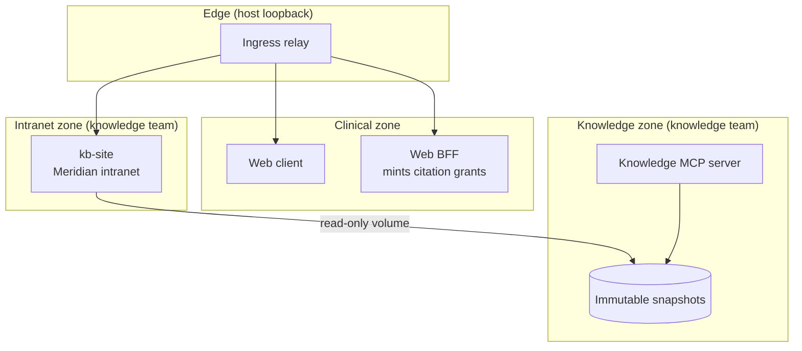

# PLAN13: The Intranet and Clickable Citations

**Status:** implemented (site and zone, identity, browsing, chips, evidence); see
[Recorded findings](#recorded-findings)
**Depends on:** [PLAN12](PLAN12.md) for the knowledge service, snapshots, personas and the
citation format; [DESIGN.md](DESIGN.md) for the citation chip.
**Shippable outcome:** every knowledge citation in a chat answer is a chip that previews the cited
lines and opens the original document on a mock company intranet, scrolled to and highlighting
those lines, at the snapshot the answer read and under the session's persona.

---

## Goal

PLAN12 made answers cite `[document@version:Lstart-Lend]`, but a citation is still text the user
has to trust. Staff check a claim by opening the source in the system it lives in: the wiki, the
document-control system, the service desk. This increment builds that place and connects
citations to it.

The site is a separate product owned by the knowledge team, reading the same published snapshots
as the knowledge service. It has its own sign-in, and it must apply the same access rules as the
broker, so a citation link never becomes a way around them.

No prompt, tool or snapshot content changes, so no cassette is re-recorded.

---

## What you can see when it's done

A replayed session as the default analyst:

1. Ask "Readqc failed on coverage for a tumor library. What minimum coverage applies now, and does
   any of our documentation say otherwise?" The answer shows chips such as
   **SOP-QC-001 v3 · L10–12** and **CHG-0021 · L12–15** where the bracket citations were.
2. Hover or focus the first chip. A preview shows lines 10–12 of the SOP as the assistant read
   them.
3. Click it. A new tab opens the Meridian QMS page for SOP-QC-001 v3, with a document-control
   header (number, version, effective status, effective dates, owner and approver roles), the
   revision history, and lines 10–12 highlighted and scrolled into view. A banner says the page
   was opened from a workbench session as Ilse Marrow (analyst).
4. Browse to the SOP-QC-001 series. Versions 2 and 3 are listed; draft v4 is not.
5. Sign in to the intranet as Odile Fenn (QA officer) with the mock sign-in. Draft v4 now appears,
   watermarked as a draft.

A chip whose citation does not match anything the assistant read in that conversation is shown as
unverified.

---

## Scope

### The site and its zone

`kb-site` is a new service in `services/knowledge` (`zknowledge.site`), owned by the knowledge
team and importing nothing from `zagent`. It is a server-rendered FastAPI application with Jinja2
templates and static CSS. Pages work without JavaScript.

- **Data:** it mounts `kb_snapshots` read-only and opens snapshots through the existing
  `IndexStore`. It never calls the knowledge MCP server.
- **Network:** a new internal `intranet` network holds only `kb-site` and the ingress relay.
  `kb-site` has no route to the agent zone, the clinical zone, the knowledge network or the
  internet. The ingress forwards one loopback port, `ZAGENT_INTRANET_PORT` (default 5180), to it.
- **Rendering:** each canonical line renders as one block with a stable `L<n>` anchor and a line
  number. Headings, list items, quotes, comment headers and table rows get styling appropriate to
  the source, but no content is reflowed across lines, so line numbers mean the same thing as in
  citations. All corpus text is escaped; no corpus Markdown or HTML is rendered as markup.

### Four source systems and a library

The intranet is branded for the invented Meridian Clinical Genomics Core. Each source system has
its own look and URL scheme, imitating the kind of product it represents without copying any
vendor's design.

| Area | Path | Page contents |
|---|---|---|
| **Wiki** (MCGC space) | `/wiki/display/MCGC/<page id>` | Space sidebar with the page tree, breadcrumbs, page version, last update and role, labels, and an archived banner |
| **Meridian QMS** | `/qms/documents/<number>/v<version>` | Document-control header, status badge (effective, draft, superseded), effective dates, owner and approver roles, revision history, supersession links; a draft watermark |
| **Meridian Service Desk** | `/servicedesk/browse/<key>` | Key, type, status, priority, components, site, reporter role, dates, description and comment thread |
| **Reference** | `/reference/tables/<table>`, `/reference/glossary` | Tables whose rows link to their source lines; an A–Z glossary with synonyms |
| **Library** | `/library/<article>` | Encyclopedia articles with revision ID, retrieval date and the CC BY-SA attribution from the NOTICE |

A resolver, `/d/<document>?snapshot=<id>&lines=<a>-<b>&q=<quote>`, redirects to the
source-specific URL. Chips link through it, so the client never needs to know source URL schemes.

### Browsing

- **Home:** the four systems and the library, with recent updates.
- **Indexes:** the wiki page tree, the QMS register with status filters, the service desk issue
  list with type and status filters, the table list, and the library index.
- **Search:** one search box over all sources, using the existing ranking and the signed-in
  persona's visibility, with results grouped by source.
- **Versions:** the QMS series page lists the visible versions; wiki and service desk pages show
  their version and update metadata.

### Highlighting and snapshots

- `lines=10-12` highlights those lines on the server and the page opens at `#L10`.
- `q=` carries the quotation that precedes the citation in the answer, if any. Where it occurs in
  the highlighted lines, it is emphasized as well.
- `snapshot=` opens that retained snapshot, so the highlighted lines are the ones the answer read.
  If a newer snapshot changes the document, a banner links to the current version. If the snapshot
  is no longer retained, the site shows the current version and says so instead of highlighting
  lines that may have moved.

### Sign-in and citation grants

There is no real authentication; identity is simulated as in PLAN12, but verification is real.

- **Mock sign-in:** the intranet sign-in page lists the four synthetic staff members and sets a
  session cookie for the chosen one. It is labeled as a simulation of single sign-on.
- **Citation grants:** a chip posts a form to `POST /api/sessions/<id>/citations/open` with the
  cited document, snapshot, lines and quote. A form post rather than a link keeps the quotation out
  of URLs and access logs, and cross-site posts are refused. The BFF checks the session, takes the
  persona, site and roles from the session (never from the request), signs a grant and redirects
  to the site.
- **Grant format:** an EdDSA JWT with audience `zknowledge-site`, the session's site and roles,
  the document, snapshot and lines, a 60-second lifetime and a unique ID. A new key pair is created
  by the key-initialization job: the signing key is mounted only on the BFF and the verification
  key only on `kb-site`.
- **Redemption:** the site verifies the grant, rejects reuse within its lifetime, sets its session
  cookie for that persona, and redirects to the clean document URL so the grant does not stay in
  the address bar or history. A grant replaces any persona chosen through the mock sign-in, and
  the page says so.
- **Access rules:** every page, index, search result, glossary entry, reference row, version list
  and supersession link is filtered by the signed-in persona's site and roles. A forbidden
  document returns the same not-found page as a missing one. Signed-out visitors see only
  documents visible to all sites and roles.
- **Identifiers:** pages show the published text as is, including the planted synthetic MRNs in
  two tickets, to personas who can see those tickets. This matches the chat's display path, which
  also shows resolved values.

### Citation chips in chat

- **Parsing:** a remark plugin finds `[document@version:Lstart-Lend]` and `[document@version:L<n>]`
  in assistant Markdown, including citations the model wrapped in a Markdown link, and renders a
  chip. The prompt is unchanged.
- **Label:** document number and version from the matching read result, for example
  **SOP-QC-001 v3 · L10–12**, falling back to the raw citation.
- **Preview:** hover or focus shows the cited lines from the earliest `read_document` result in the
  same conversation that covers them, in its display representation. No extra request is made.
- **Unverified:** a citation with no matching read result is styled as unverified and its preview
  says so. It still links to the site, so the user can check.
- **Click:** submits a form with `target="_blank"` to the BFF redirect from the click itself, so
  pop-up blockers do not interfere.
- **Where:** chat only. X-ray's model pane keeps the raw citation text, because that is what the
  model wrote.
- **Design:** the chip lives in `components/chat/`, takes its data as props, and follows
  DESIGN.md, with stories in both themes and keyboard access.

### Staging

1. **Site and zone.** `kb-site`, the `intranet` network, the ingress port, document pages for every
   source with line anchors and highlighting, the resolver, escaping and a restrictive Content
   Security Policy, and zone probes. Signed-out visibility only.
2. **Identity.** Mock sign-in, grant key pair, BFF mint-and-redirect endpoint, redemption, and
   access parity with the broker, with their mutations.
3. **Browsing.** Home, indexes, search, version and supersession views, the glossary, reference
   tables and the library.
4. **Chips.** Parsing, the chip and preview, click-through and the unverified state, with stories,
   design checks and browser tests.
5. **Evidence and docs.** The citation-resolution invariant over every recorded citation, README
   quick start, ARCHITECTURE and evals README.

---

## Out of scope

| Item | Where |
|---|---|
| Real authentication or SSO | not a goal |
| Editing, comments or page history diffs on the intranet | not a goal; the site is read-only |
| A document viewer inside the working surface (MCP App) | later, if the separate site proves insufficient |
| Changing the prompt, tools or citation format | not in this plan; it would require a re-record |
| Changing what snapshots contain | not in this plan; see Traps |
| Chips in job cards or X-ray | not in this plan |
| Operational data (runs, instruments, reagent lots, per-library QC) | PLAN14 |

---

## Key decisions

**A separate site, not a panel.** Checking a source means leaving the assistant and opening the
system of record. A separate product owned by the knowledge team is the realistic shape, and it
keeps the knowledge team's pages out of the agent's UI and design system. PLAN12 suggested an MCP
App in the working surface; this plan replaces that idea.

**Render what the agent read.** Pages come from the published snapshot's canonical lines, and
links pin the snapshot. The highlighted text is therefore exactly the text behind the citation,
not the latest edit of the page.

**The BFF vouches for the persona.** The chat client cannot choose who it is on the intranet; the
BFF derives the persona from the session and signs a short-lived, single-use grant. The mock
sign-in exists for browsing and is labeled as a simulation.

**Same rules, independently enforced.** The site applies the knowledge service's visibility rules
itself. Parity with the broker is a tested invariant, not an assumption.

**No new model-visible content.** Chips are parsed in the client from the existing citation
format, so this plan costs no provider calls and no cassette changes.

**Previews come from the conversation.** The preview shows what the assistant actually read,
from tool results the client already has, so it needs no fetch and raises no access question.

**Flag citations the conversation cannot support.** A chip that matches no read result is marked
unverified rather than hidden, which makes fabricated citations visible to the user.

**The intranet is outside the design system.** It imitates other products and does not use the
workbench's tokens. It still meets keyboard and contrast expectations. The chip, which lives in
the workbench, follows DESIGN.md.

---

## Definition of done

- [x] `kb-site` runs only on `intranet`, reads snapshots read-only, and is reachable only through
  its ingress port. `make zones` proves it cannot reach the agent zone, clinical services, `kb` or
  the internet, and that the agent zone cannot reach it.
- [x] Every document in the current snapshot renders on its source-specific page, with one anchor
  per canonical line and every line's text equal to the snapshot's line.
- [x] The resolver, highlighting, quote emphasis, pinned snapshots and the expired-snapshot banner
  work as described.
- [x] Corpus text, including the injection payloads, is escaped on every page, and pages are
  served with a Content Security Policy that forbids inline scripts.
- [x] Mock sign-in and citation grants work end to end in the Compose stack. Forged, expired,
  reused and wrong-audience grants are rejected, and the client cannot choose the persona.
- [x] For every persona, site visibility matches the broker's for documents, search, indexes,
  version lists, supersession links, glossary entries and reference rows, and forbidden documents
  are indistinguishable from missing ones.
- [x] Home, indexes, search, version views, the glossary, reference tables and the library are
  browsable.
- [x] Every citation in the recorded goldens and execution transcripts renders as a chip, previews
  the cited lines, and resolves on the site to exactly those lines.
- [x] The chip passes `npm --prefix apps/web run test:design`, and browser tests cover hover, click
  and the analyst-versus-QA difference.
- [x] Every new mutation is detected.
- [x] No cassette changes, and the full replay matches the PLAN12 baseline.
- [x] README quick start, ARCHITECTURE (sections 6, 12 and 14), the evals README and AGENTS.md
  (the new port for side-by-side clones) are updated. The requirement register is unchanged; see
  the findings.

---

## Evidence added

| Requirement | Tier | Statement | Evidence |
|---|---|---|---|
| REQ-CITE-01 | Invariant | Every citation chip resolves on the intranet to the cited lines of the cited snapshot, and those lines equal the text the agent read | Every citation in the recorded cassettes, checked against the site; every golden citation renders as a verified chip; mutation `site_unpinned` |
| REQ-ACL-03 | Invariant | The intranet shows a persona exactly the documents the broker would, everywhere a document can appear, and forbidden documents are indistinguishable from missing ones | Per-persona parity over all documents and listings; mutation `site_acl_off` |
| REQ-ACL-04 | Invariant | Only a valid, unexpired, unused grant minted by the BFF for the session's own persona can sign a visitor in from a citation | Forged, expired, reused and wrong-audience grant tests; mutation `site_trust_unsigned_grant` |
| REQ-KB-06 | Invariant | The intranet zone reaches only the snapshot volume, and only the ingress reaches it | Zone probes; mutation `site_direct_route` |

These existing requirements are extended:

- **REQ-VIEW-03:** opening a citation, like opening a view reference, has no workflow side effects:
  no conversation turn, draft change or job submission. Covered by the browser suite on desktop
  and mobile.
- **REQ-PHI-01/02:** unchanged; chips add no model-visible content and the preview uses the display
  representation already sent to the client.

---

## Traps

**Changing the snapshot changes the model's input.** Every knowledge result carries the snapshot
ID, and the ID is a digest of the snapshot's content. Adding a column or table for the site would
change every recorded request. Render from what snapshots already hold (canonical lines, sections,
metadata and provenance); if the site needs more, publish it in a separate file beside the
snapshot, outside the digest.

**The corpus is hostile.** Wiki pages and tickets contain prompt-injection payloads and
HTML-looking text, and adversarial cases publish deliberately poisoned snapshots. Escape
everything, never render corpus Markdown as HTML, and send a Content Security Policy.

**Existence oracles move to the site.** A "superseded by v4" banner, a page-tree entry, a search
count, a glossary entry citing a restricted page, or a different error for forbidden and missing
documents each reveals what PLAN12 hides. Test each listing, not just document pages.

**Grants in URLs leak.** URLs end up in history, logs and referrers. Keep grants single-use and
short-lived, redirect to a clean URL immediately, send `Referrer-Policy: no-referrer`, and never
log the grant.

**Two personas at once.** A user may be signed in to the intranet as one persona and click a
citation from a session with another. The grant wins, and the page states whose view it shows.

**Lines that moved.** A citation's line numbers are only meaningful in its snapshot. Never
highlight a range against a different snapshot.

**Pop-up blockers.** Opening a tab after an asynchronous request is blocked by browsers. Submit a
form or follow a link to a redirecting endpoint from the click itself.

**The team boundary again.** `zknowledge.site` cannot import the agent's JWT code or persona
registry. Duplicate the verification and the staff directory, and test agreement from the agent
side.

**A new port for side-by-side clones.** Clones that share the default ports collide. Add
`ZAGENT_INTRANET_PORT` to the `.env` example in AGENTS.md.

---

## After this

- PLAN14: operational data in the clinical zone (runs, instruments, reagent lots, per-library QC
  metrics), so questions can combine query handles with knowledge thresholds and known-issue
  tickets.
- Deep links from job cards and refusal messages to relevant intranet pages.
- Other teams' MCP servers attached through the broker.

---

## Recorded findings

**Evidence.**

- All 208 documents in the published snapshot (23 QMS versions, 63 wiki pages, 20 tickets, 10
  reference documents, 92 library articles; 13,216 canonical lines) render with one anchor per
  line whose text equals the snapshot's line.
- The recorded cassettes hold 27 citations. `test_citations.py` opens each one on the site through
  a real grant: 24 against the published snapshot and 3 against the two poisoned snapshots the
  wiki and ticket injection cases published, which the test rebuilds. The highlighted lines equal
  the lines the agent read in every case. One cited line carries a tokenized MRN; the test matches
  `[PT_1]` to the identifier on the page by the patient rule. The 14 citations in the goldens all
  render as verified chips in a client test.
- Parity: for four personas at Northgate and the analyst at Lakeside, every document opens exactly
  when the index allows it, every index lists exactly those documents, and no page the visitor can
  open (version histories, series pages, supersession links, glossary and table sources) links to
  one they cannot. On the agent side, the broker and the site agree on the restricted documents
  for all four personas at all five sites.
- `make zones`: 21 services, 219 checks, all passing, including REQ-KB-06.
- `make evals MUTATE=all`: all nineteen mutations detected with healthy controls.
- Full replay: 3,606 trials, no unrecognized regressions, the same 12 known findings as PLAN12.
  No cassette or golden changed, and the privacy scan of 1,394 cassettes found no violations.
- Design checks: the nine chip and chat stories pass at every viewport in both themes. Browser
  tests pass on desktop and mobile; opening a citation leaves the session's event sequence
  unchanged (REQ-VIEW-03).
- Full pytest: 755 passed, 1 skipped; 150 client unit tests pass.

**Changes from the plan.**

- The chip submits a form instead of following a link, so the quotation never appears in a URL
  or an access log. The BFF also refuses posts marked `Sec-Fetch-Site: cross-site`.
- REQ-CITE-01 needed a mutation that breaks it, so `site_unpinned` (the site ignores the pinned
  snapshot) was added. Its probe republishes one SOP line and opens a citation pinned to the
  earlier snapshot.
- The new requirements are not in `evals/requirements.yaml`. That register links requirements to
  eval cases, and a requirement without cases is reported as uncovered and fails the gate.
  Like PLAN12's REQ-ACL-02 and REQ-KB-03, they are backed by tests and paired mutations; REQ-KB-06
  is reported by `make zones` like REQ-KB-01.
- Chip labels come from the document number (`SOP-QC-001 v3`, `INC-0142`, `Wiki 40152`), so even
  an unverified chip is readable. Reference and library citations use the title from the read.
- In live mode the model once put a citation in a link's address,
  `[quoted sentence](wp-variant-call-format@1373132868:L3)`, despite the prompt asking for plain
  text. The chat dropped the unsafe address and showed no citation. The parser now keeps the link
  text and adds a chip after it. The prompt is unchanged, and the evaluation still counts that form
  as uncited.

**Problems found while building.**

- The main ingress relay listens on every network it joins. Putting the site on the edge network
  beside it would have given the site a route to Postgres through the relay, so the intranet got
  its own relay.
- A `<button>` cannot be fully inline, so a long title wraps as a block rather than flowing with
  the sentence. Document-number labels keep real chips short; the long-title story shows the
  worst case.
- `max-w-96` overflowed a 360-pixel phone, so DESIGN.md gained a `max-w-preview` token bounded by
  the viewport. Previews show at most eight lines.
- On phones the intranet's sticky header covered the first cited line; the header is now static
  on narrow screens and lines have a scroll margin.
- Previews show the line text exactly as the assistant read it, including Markdown markers such as
  `## `.
- Two clones running evaluations at once share the host gateway audit database and can fail with
  `database is locked`. Set `ZAGENT_GATEWAY_AUDIT` per clone.
